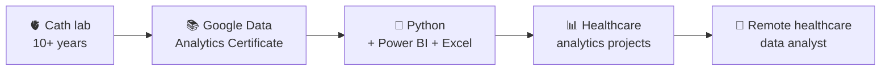

  

  <b>🫀 10+ years in the cath lab &nbsp;→&nbsp; 📊 turning hospital data into decisions</b> 
  Python · Power BI · Excel · SQL &nbsp;|&nbsp; أهلاً 👋 أنا يسرا

  
  
  

---

## 🩺 → 📊 My story

I spent **10+ years in cardiac catheterization and critical care**, running a cath lab where supplies, cases and infection control had to be right every single day. That taught me how hospitals really work, and where their data goes missing.

Now I build **healthcare analytics projects that turn hospital data into decisions**: market models, simulations, risk engines and dashboards.

## 🧬 What the cath lab taught me about data

| In the cath lab | In analytics |
|---|---|
| Planning supplies so nothing runs out on the busiest day | Supply simulations that stress-test plans at peak demand |
| Watching infection and complication rates | Dashboards that make safety metrics visible |
| Deciding which patients need attention first | Risk stratification and prioritization scoring |
| Explaining protocols to doctors and teams | Turning numbers into stories executives act on |

---

## 🚀 Featured project

<table>
<tr>
<td width="62%">

### 🫀 GCC TAVI Market Opportunity Model
End-to-end commercial analytics and market sizing for TAVI across the GCC: a clinical funnel, hospital prioritization scoring, uncertainty ranges and a reality check against published Gulf registry data.

`Python` `Streamlit` `Plotly`

[▶ **Open the live dashboard**](https://tavi-gcc-market-opportunity-mode-iy7nxbmcjkkcg6eudp7aud.streamlit.app/) · [Code](https://github.com/yosras-dotcomAi/TAVI-GCC-market-opportunity-mode) · [Slides](SLIDESHARE-LINK)

Built only from public data. Independent project, not affiliated with any manufacturer or employer.

</td>
<td width="38%" align="center">

**9,478** eligible patients (base case)

**$18.4M** annual market value

**65%** of the 75+ population is in Saudi Arabia

</td>
</tr>
</table>

## 🧪 More projects

<table>
<tr>
<td width="50%" valign="top">

### 🕋 [hajj-supply-readiness](https://github.com/yosras-dotcomAi/hajj-supply-readiness)
Where does a medical supply plan break at **5x peak demand**? A simulation for a fictional Hajj field hospital, on synthetic data. 
`Python` `Power BI`

</td>
<td width="50%" valign="top">

### 🫀 [CardioMetabolic-LOS-Engine](https://github.com/yosras-dotcomAi/CardioMetabolic-LOS-Engine)
Clinical risk stratification and a hospital length-of-stay impact engine for operational transformation. 
`Python`

</td>
</tr>
<tr>
<td width="50%" valign="top">

### 🧫 [cath-lab-access-site-infection](https://github.com/yosras-dotcomAi/cath-lab-access-site-infection)
An infection control dashboard that explains the infection rate one step at a time. 
`Python`

</td>
<td width="50%" valign="top">

### 🏥 [1000-Bed-Hospital-](https://github.com/yosras-dotcomAi/1000-Bed-Hospital-)
A fictional 1,000-bed hospital: bed capacity, operational performance, KPI validation and an executive dashboard. 
`Excel` `Power BI`

</td>
</tr>
<tr>
<td width="50%" valign="top">

### 📈 [health-improvement-programs-analysis](https://github.com/yosras-dotcomAi/health-improvement-programs-analysis)
Do patients in health improvement programs do better than those who aren't? 
`Python` `matplotlib`

</td>
<td width="50%" valign="top">

### 📂 [Everything else](https://github.com/yosras-dotcomAi?tab=repositories)
Learning repos, practice projects and experiments live here. 
`17 repositories`

</td>
</tr>
</table>

---

## 🛠️ Toolbox

  
  
  
  
  
  
  
  

**🏥 Healthcare domain:** cardiac cath lab operations · infection control · supply and inventory planning · Epic EHR analytics

## 🌱 Right now

- 📜 Preparing for **Microsoft PL-300** (Power BI Data Analyst)
- 🏗️ Growing my healthcare analytics portfolio, one real hospital problem at a time
- 🎙️ Building **Beyond the Nursing**, a podcast for nurses exploring careers beyond the bedside

<b>🎓 Certifications and learning</b>

 

- ✅ Google Data Analytics Professional Certificate (Coursera, 2026)
- ✅ Introduction to Data Analysis Using Python (Google)
- ✅ Harnessing the Power of Data with Power BI (Microsoft)
- ✅ Preparing Data for Analysis with Microsoft Excel
- 🔄 Microsoft PL-300 (in preparation)

## 💬 Ask me about

Cath lab operations · moving from clinical work into data · building a healthcare analytics portfolio · hospital supply and capacity planning

---

  <b>Working on healthcare analytics, hospital operations or health strategy?</b> 
  <a href="https://www.linkedin.com/in/yosra-nagar-9a6862118/">💬 Let's talk on LinkedIn</a>

  

